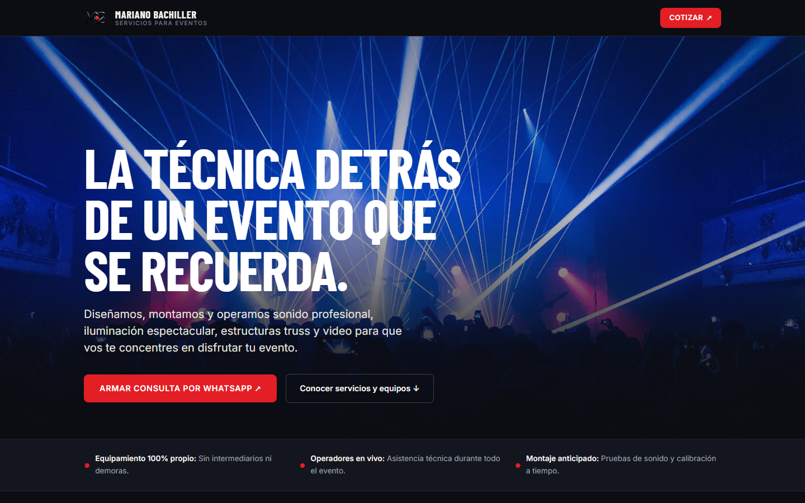
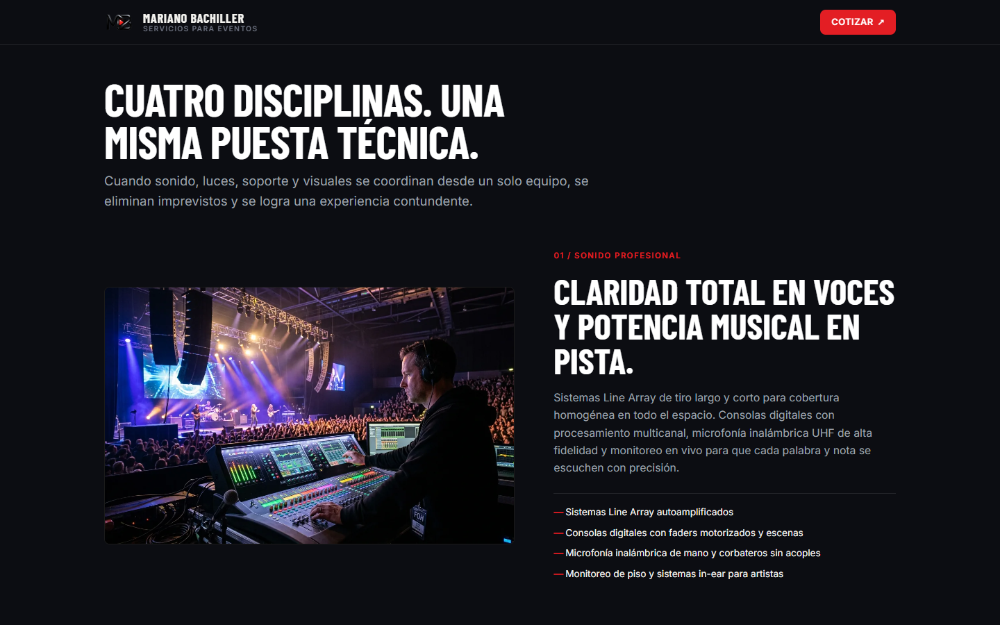
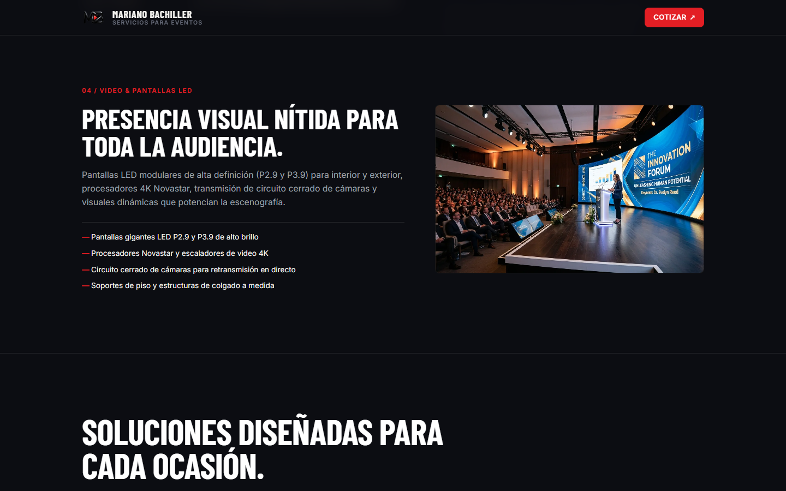
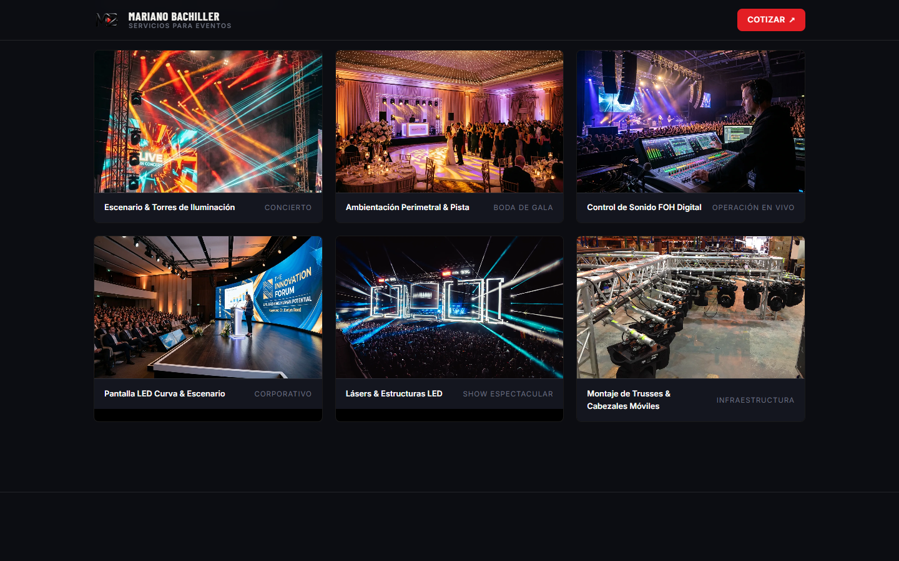
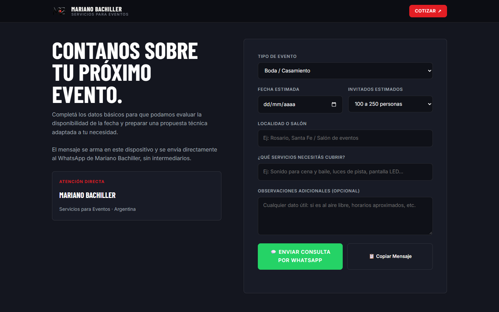

# MB Eventos: sitio de presentación

Sitio de presentación para **MB, Mariano Bachiller, Servicios para Eventos**, una empresa de sonido, iluminación, estructuras y pantallas LED. Está pensado para quien llega desde un **código QR impreso** (folletos, presupuestos, cartelería): carga rápido en el celular, muestra el trabajo y termina en una consulta por WhatsApp ya armada.

Es la contraparte comercial de [MB Systems](https://github.com/bachillerfran-afk/mb-systems), el sistema de reservas del mismo negocio.



## Qué resuelve

Antes, el cliente escribía "¿cuánto sale?" y empezaba un ida y vuelta para saber tipo de evento, fecha, cantidad de invitados y lugar. El formulario final arma ese mensaje completo en el dispositivo del cliente y lo abre en WhatsApp. El negocio recibe una consulta que ya se puede cotizar, sin pasar por backend ni base de datos.

## Características

- **Una sola página HTML autocontenida.** CSS y JS van inline y las fuentes y medios son locales: no hay CDN ni recursos externos en tiempo de ejecución. Funciona offline y se puede alojar en cualquier hosting estático.
- **Mobile first.** Diseñado primero para 390 px y ampliado con breakpoints en 700 y 960 px.
- **Rendimiento.** Imágenes en WebP optimizadas, `loading="lazy"` en todo lo que está debajo del primer pantallazo y loops de video cortos en WebM sin audio, con poster. El sitio completo pesa unos 4 MB.
- **Cuatro disciplinas** (sonido, iluminación, estructuras, video/LED), soluciones por tipo de evento, galería y proceso de trabajo.
- **Constructor de consulta.** Formulario con tipo de evento, fecha, invitados, lugar y servicios que genera el texto y lo envía por `wa.me` o lo copia al portapapeles.
- **Accesibilidad básica.** Jerarquía de encabezados, etiquetas en los controles y región `aria-live` para avisar cuando se copia el mensaje.
- **Dirección visual.** Estilo editorial oscuro con un solo color de acento, sin animaciones invasivas, scroll hijacking ni loaders.

## Capturas

| Disciplinas | Soluciones |
| --- | --- |
|  |  |

| Galería | Consulta por WhatsApp |
| --- | --- |
|  |  |

<p align="center"></p>

## Estructura

```
index.html                 # Página completa (HTML + CSS + JS inline)
assets/
├── fonts/                 # Barlow Condensed e Inter (WOFF2, licencia OFL incluida)
├── demo-media/optimized/  # Fotos y loops de demostración (WebP / WebM)
└── mb-*.png|webp          # Marca de MB
CREDITS.md                 # Fuente y licencia de cada medio
```

## Ver localmente

No necesita build. Se puede abrir `index.html` directamente en el navegador o servirlo:

```bash
npx serve .
```

## Estado

Es una **maqueta funcional lista para mostrar al cliente**. Los medios son de demostración: algunos son fotos con licencia Creative Commons (detalladas en [CREDITS.md](CREDITS.md)) y otros son imágenes ilustrativas. Antes de publicarla de forma comercial hay que reemplazarlos por material propio de MB. La estructura está pensada para que ese cambio sea solo cambiar archivos.

## Créditos

- Fotografías CC BY / CC BY-SA de Wikimedia Commons, con autor y licencia en [CREDITS.md](CREDITS.md).
- Tipografías Barlow Condensed e Inter, bajo SIL Open Font License 1.1.
- La marca MB fue provista por el cliente.
